# My dotfiles

✨ **_This is my dotfiles. Take anything you want, but at your own risk. It mainly targets MacOS systems._** ✨

# Table contents

- [Tools](#tools)
- [CLI Replacements](#-cli-replacements)
- [Setup](#%EF%B8%8F-setup)
  - [Installing](#installing)
  - [Add configuration](#add-configuration)
    - [Configuration shell (fish)](#configuration-shell-fish)
    - [Configuration git + ssh](#configuration-git--ssh)
    - [Configuration neovim](#configuration-neovim)
  - [System Maintenance](#-system-maintenance)
    - [Update packages](#update-packages)
    - [Clean packages](#clean-packages)
    - [Checkout packages](#checkout-packages)
    - [Nodejs](#nodejs)
    - [Cmus](#cmus)
- [Show case](#show-case)

# Tools

- **Package Manager**: [Nix](./nix-darwin)
- **Terminal**: [Kitty](./kitty) / [Ghostty](./ghostty)
  - **Multiplexer**: [Tmux](./tmux)
- **Shell**: [Fish](./fish)
  - **Theme**: [Starship](./starship)
- **IDE**: [Neovim](./neovim)
- **Window Management**: [Yabai](./yabai) + [skhd](./skhd)
- **Activity Monitor**: [Btop](./btop)
- **Git**:
  - [Lazygit](./lazygit)
  - [delta](https://github.com/dandavison/delta) - a syntax-highlighting pager for git, diff, and grep output
- **File Manager**:
  - [Yazi](./yazi/)
- **Version Manager**:
  - [fnm](https://github.com/Schniz/fnm) - 🚀 fast and simple Node.js version manager, built in Rust
- **Font**: [Nerd Font](https://github.com/ryanoasis/nerd-fonts)
  - _**JetBrainsMono**_
  - [JetBrainsMono Nerd Font](https://github.com/JetBrains/JetBrainsMono)
  - [Iosevka Nerd Font](https://github.com/be5invis/Iosevka)
- **Music**: [cmus](./cmus) + [cava](./cava) + [blackhole](https://github.com/ExistentialAudio/BlackHole)
- **Keyboard Customize**: - [karabiner-elements](./karabiner) a powerful and stable keyboard customize for macOS.
- **Vietnamese Keyboard**: [OpenKey](https://github.com/tuyenvm/OpenKey)
- **Wallpapers**: [Wallpapers](./wallpapers)
- **Music**: [Music](./Music)

# ⚡ CLI Replacements

- [bat > cat ](https://github.com/sharkdp/bat)
- [fd > find](https://github.com/sharkdp/fd)
- [sd > sed](https://github.com/chmln/sd)
- [rg(ripgrep) > grep](https://github.com/BurntSushi/ripgrep)
- [eza > ls](https://github.com/eza-community/eza)
- [delta > diff](https://github.com/dandavison/delta)
- [btop > top](https://github.com/aristocratos/btop)
- [tealdeer > man](https://github.com/tealdeer-rs/tealdeer?tab=readme-ov-file)
- [duf > df](https://github.com/muesli/duf)
- [dust > du](https://github.com/bootandy/dust)
- [prettyping > ping](https://github.com/denilsonsa/prettyping)

# ⚙️ Setup

## Installing

> ⚠️ This configuration is designed for macOS and uses [Nix](https://nixos.org) and [nix-darwin](https://github.com/nix-darwin/nix-darwin) to manage system packages, tools, and applications.

### 1. Install Xcode Command Line Tools

Install Apple's Command Line Tools, which provide Git and other essential development utilities.

```sh
xcode-select --install
```

Verify the installation:

```sh
git --version
```

### 2. Install Nix

Install Nix using the official installer:

```sh
sh <(curl --proto '=https' --tlsv1.2 -L https://nixos.org/nix/install)
```

Restart your terminal after installation and verify:

```sh
nix --version
```

### 3. Clone dotfiles

Download the configuration repository:

```sh
git clone git@github.com:hungvx-dev/Dotfiles.git ~/dev/dotfiles
```

> **Note:** The SSH URL requires a configured GitHub SSH key. Alternatively, use HTTPS:

```sh
git clone https://github.com/hungvx-dev/Dotfiles.git ~/dev/dotfiles
```

### 4. Bootstrap nix-darwin

Install and activate the nix-darwin configuration:

```sh
sudo nix --extra-experimental-features "nix-command flakes" run \
  github:nix-darwin/nix-darwin#darwin-rebuild -- \
  switch --flake ~/dev/dotfiles/nix-darwin/eryx#dev
```

This command bootstraps nix-darwin and activates the `dev` system configuration.

After the first successful activation, rebuild using:

```sh
sudo darwin-rebuild switch --flake ~/dev/dotfiles/nix-darwin/eryx#dev
```

### 5. Link dotfiles

Use GNU Stow to create symlinks for your configuration files:

```sh
cd ~/dev/dotfiles

# Preview changes
stow -nvt "$HOME" .

# Apply configuration
stow -vt "$HOME" .
```

> **Note:** This assumes the repository root is organized as a Stow package. Review the preview before applying to avoid conflicts with existing files.

## Shell configuration (Fish)

### Set Fish as the default shell

After nix-darwin has installed Fish, register it in `/etc/shells` and set it as the default shell:

```sh
fish_path="$(command -v fish)"

grep -qxF "$fish_path" /etc/shells || \
  echo "$fish_path" | sudo tee -a /etc/shells

chsh -s "$fish_path"
```

Restart your terminal or log out and log back in to use Fish.

### Install Fisher (Optional)

[Fisher](https://github.com/jorgebucaran/fisher) is a plugin manager for Fish.

Run the following commands inside Fish:

```fish
curl -sL https://raw.githubusercontent.com/jorgebucaran/fisher/main/functions/fisher.fish | source
fisher install jorgebucaran/fisher
```

Install the optional Zoxide integration:

```fish
fisher install kidonng/zoxide.fish
```
### Configuration git + ssh

- Git

```sh
cd ~/dev/dotfiles
ln -s $(pwd)/git/me/ ~/.config/git
ln -s $(pwd)/git/me/.gitconfig ~/.config/git/config
```

- SSH

```sh
ln -s $(pwd)/ssh/config ~/.ssh/config
```

- [Setup ssh](./ssh/guide.md)

## Editor Setup

### 1. Enter development environments

Enter both development shells:

```fish
dev
tools
```

- `dev` provides Mise and the development runtimes.
- `tools` provides Tree-sitter CLI and other system utilities.

### 2. Install development tools with Mise

Mise manages the runtimes and toolchains required by the Neovim environment.

Tool versions are defined in `mise/config.toml`:

```toml
[tools]
bun = "latest"
node = "latest"
pnpm = "latest"
go = "latest"
rust = "latest"
uv = "latest"

[settings]
experimental = true
```

Install all configured tools:

```sh
mise install
```

Verify installed tools:

```sh
mise ls
```

### 3. Install Neovim LSP servers

Start Neovim:

```sh
nvim
```

Open Mason:

```vim
:Mason
```

Install the required LSP servers, formatters, and other development tools.

### 4. Install Tree-sitter parsers

This configuration uses [tree-sitter-manager.nvim](https://github.com/romus204/tree-sitter-manager.nvim) to manage Tree-sitter parsers.

Open the parser manager:

```vim
:TSManager
```

Install the required parsers through the interface.

> **Note:** Keep both development environments available when running Neovim. Mise provides the required runtimes, while the Nix `tools` shell provides Tree-sitter CLI.

## ⚡ CLI Tools

### _bat_ → Pretty _cat_ with syntax highlighting

- Pretty print the contents of one or more files to `stdout`
  `bat path/to/file1 path/to/file2 ...`

### _fd_ → Fast _find_ replacement

- Recursively find files matching a specific pattern in the current directory:
  `fd "string|regex"`

- Find files that begin with a specific string:
  `fd "^string"`

- Find files with a specific extension:
  `fd [-e|--extension] txt`

- Find files in a specific directory:
  `fd "string|regex" path/to/directory`

- Include ignored and hidden files in the search:
  `fd [-H|--hidden] [-I|--no-ignore] "string|regex"`

- Execute a command on each search result returned:
  `fd "string|regex" [-x|--exec] command`

### _rg (ripgrep)_ → Super fast _grep_ replacement

`rg [OPTIONS] PATTERN [PATH...]`

- Recursively search current directory for a pattern (`regex`):
  `rg pattern`

- Recursively search for a pattern in a file or directory:
  `rg pattern <path/to/file_or_directory>`

- Options
  - Include hidden files and entries listed in `.gitignore`:
    `[-.|--hidden] --no-ignore`

### _sk_ - Fuzzy finder written in Rust. Similar to _fzf_

- Start `skim` on all files in the specified directory:

  `fd "string|regex" path/to/directory | sk`

### _Ollama_

- Start the daemon required to run other commands: `ollama serve`
- Run a model and chat with it: `ollama run <model>`
- List downloaded models: `ollama ls`
- Pull a specific model: `ollama pull <model>`
- Delete a model: `ollama rm <model>`

## 🔄 System Maintenance

### Nix usage

Navigate to the `nix-darwin/eryx` directory first:

```bash
cd ~/dev/dotfiles/nix-darwin/eryx
```

#### Development environments

Enter a development shell using the Fish aliases:

```fish
dev    # Enter develop#dev
tools  # Enter develop#tools
```

Development environments are defined in `develop/flake.nix`.

To create persistent profiles and keep development packages available after garbage collection:

```bash
mkdir -p .nix-profiles

nix develop --profile .nix-profiles/dev ./develop#dev
nix develop --profile .nix-profiles/tools ./develop#tools
```

Keep `.nix-profiles/` out of Git. These profiles act as local GC roots and do not need to be committed.

#### Update and rebuild

- Update flake inputs (`flake.lock`):

  ```bash
  nix flake update
  ```

- Rebuild and activate the system configuration:

  ```bash
  sudo darwin-rebuild switch --flake .
  ```

- Update and rebuild in one command:

  ```bash
  nix flake update && sudo darwin-rebuild switch --flake .
  ```

#### Optimise Nix store

Deduplicate identical files in the Nix store to reclaim disk space:

```bash
nix store optimise
```

#### Garbage collection

- Garbage collect unused store paths:

  ```bash
  nix store gc
  ```

- Delete old generations and garbage collect (optional):

  ```bash
  sudo nix-collect-garbage -d
  ```

The second command removes old generations before collecting unreferenced store paths.

Garbage collection is not required after rebuilding or when entering a development shell. Keep `.nix-profiles/` intact to preserve the development environments.

#### System generations

- List generations:

  ```bash
  sudo darwin-rebuild --list-generations
  ```

- Roll back to the previous generation:

  ```bash
  sudo darwin-rebuild switch --rollback
  ```

- Switch to a specific generation:

  ```bash
  sudo darwin-rebuild switch --switch-generation <generation-number>
  ```

#### macOS Dock

- Reset Launchpad:

  ```bash
  defaults write com.apple.dock ResetLaunchPad -bool true
  killall Dock
  ```

### Yabai

- Configure scripting addition: `echo "$(whoami) ALL=(root) NOPASSWD: sha256:$(shasum -a 256 $(which yabai) | cut -d " " -f 1) $(which yabai) --load-sa" | sudo tee /private/etc/sudoers.d/yabai`

### Nodejs

- Enable pnpm: `corepack enable pnpm`
- Disable yarn: `corepack disable yarn`

### Cmus

- Add a Music Folder `:add /path/to/your/music`
- Rescan the Library `:update-cache`
- Remove Missing Files `:clear`
- Changing the volume in cmus `:set softvol=true`

# Show cases

## Terminal (Kitty + fish + starship)

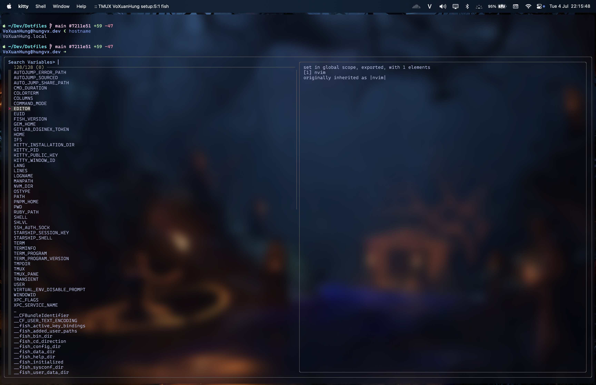
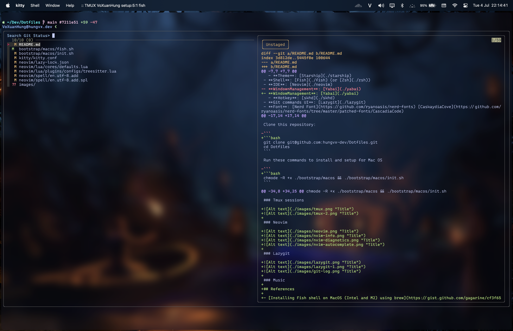

## Search (fzf + ripgrep + fd + bat)

## Multiplexer window


## Btop

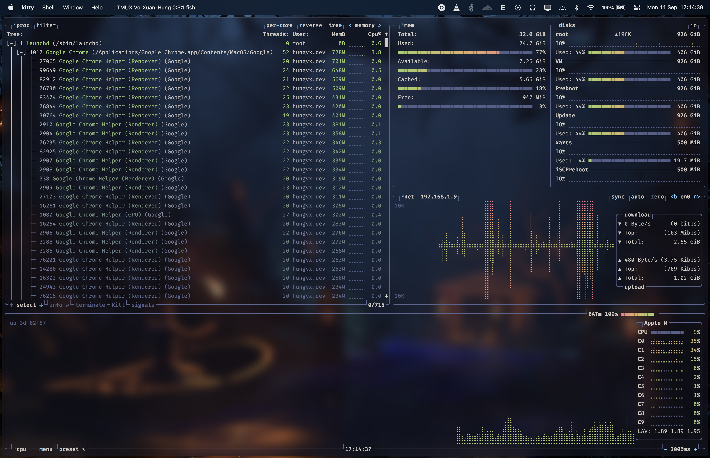

## Neovim

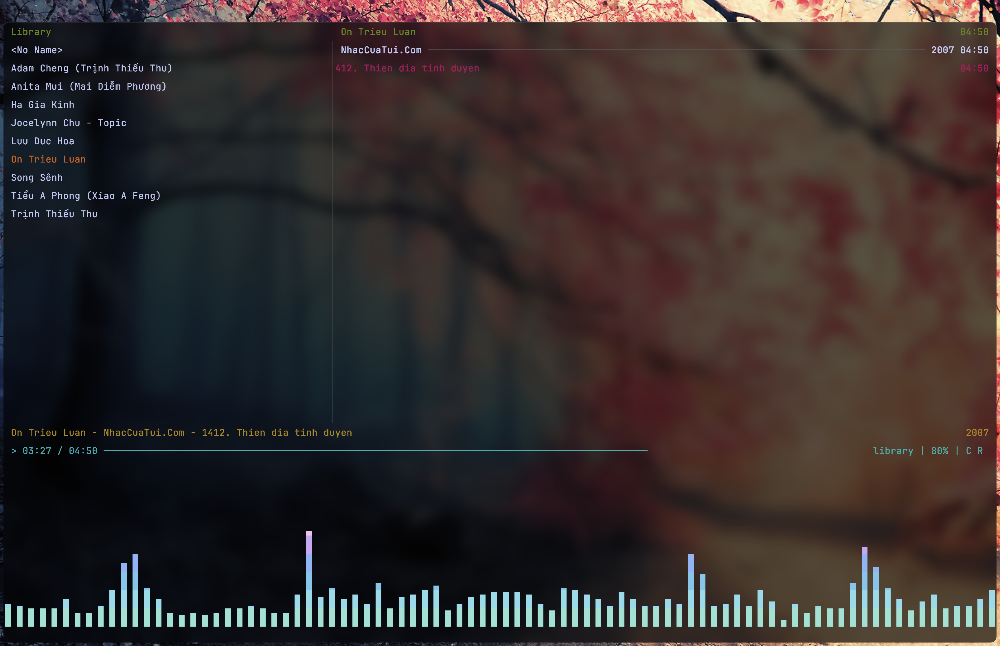
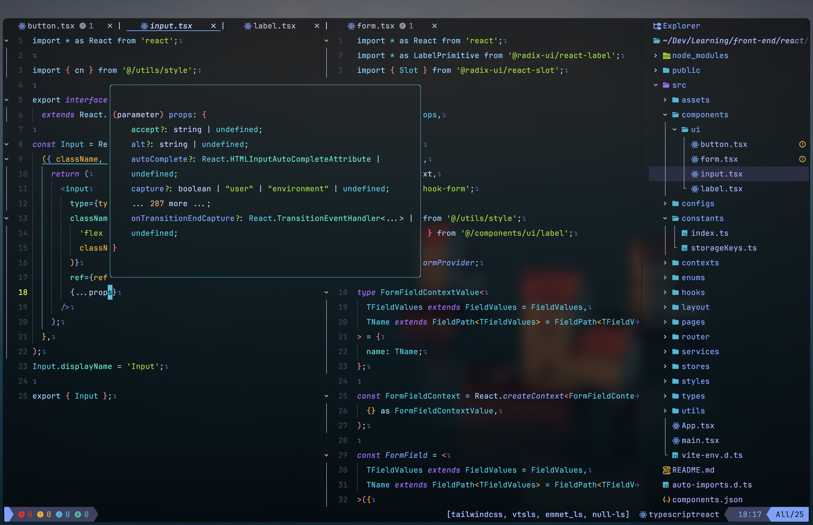
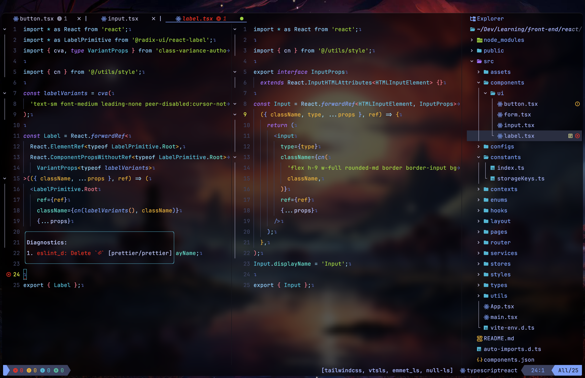
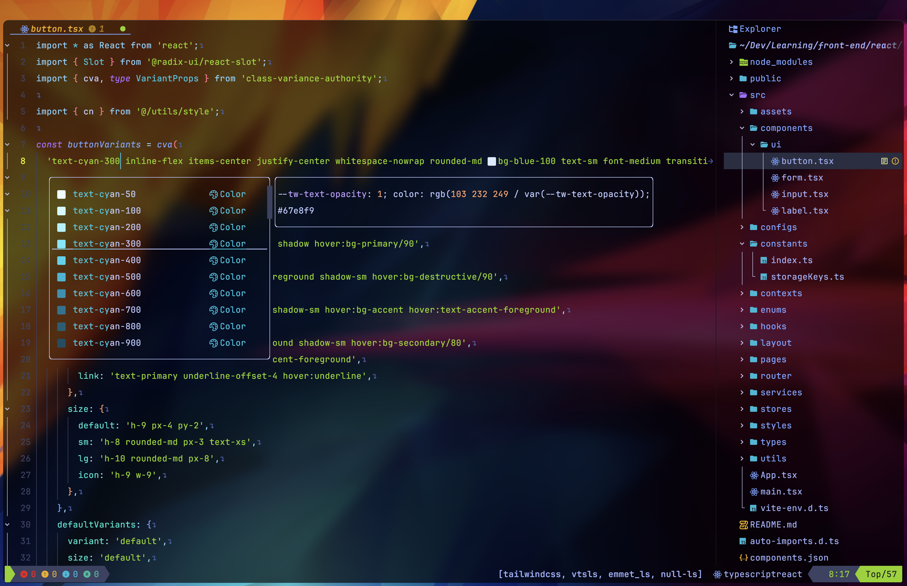
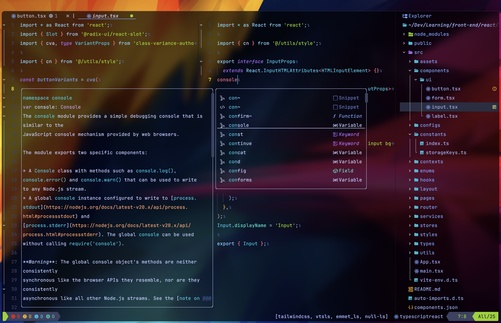

## Lazygit


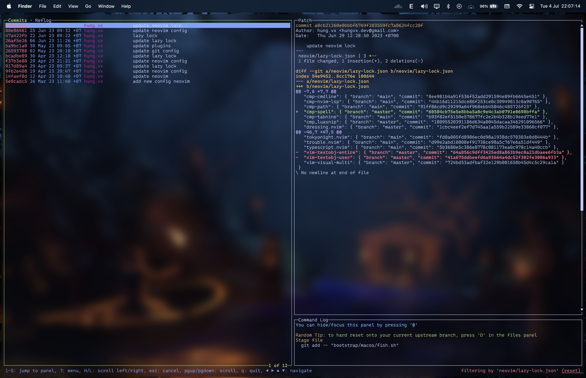
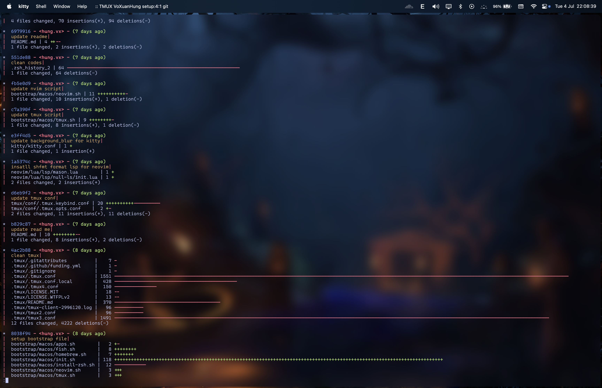

## Music

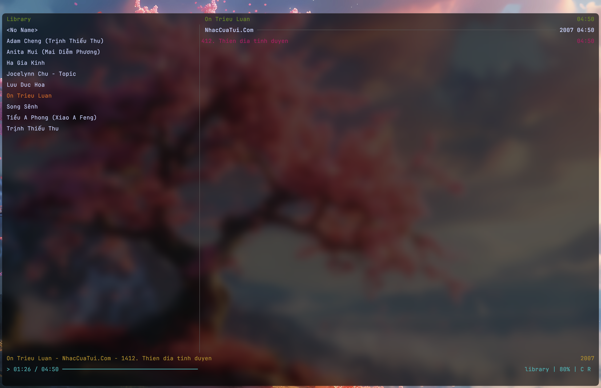
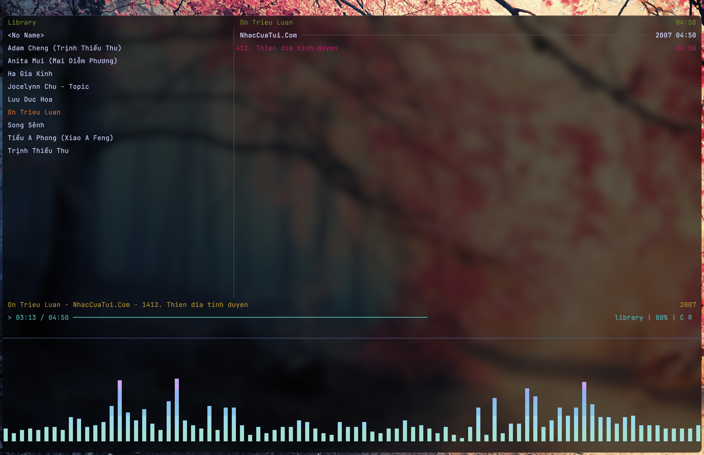

# References

## Blogs

- [CLI: Improved](https://remysharp.com/2018/08/23/cli-improved)
- [Fuzzy Finding in Vim with fzf](https://bluz71.github.io/2018/12/04/fuzzy-finding-in-vim-with-fzf.html)
- [Mike Griffin](https://mikegriffin.ie/blog/)
- [Department of Information Technology](https://www.ditig.com/)

## References

- [Installing Fish shell on MacOS (Intel and Apple Silicon) using brew](https://gist.github.com/gagarine/cf3f65f9be6aa0e105b184376f765262)
- [Installing tmux-256color for macOS](https://gist.github.com/bbqtd/a4ac060d6f6b9ea6fe3aabe735aa9d95)
- [TIL: How to Fix ”Cannot Read Termcap Database” With Tmux and Kitty on MacOs](https://www.rockyourcode.com/til-how-to-fix-cannot-read-termcap-database-with-tmux-and-kitty-on-macos/)
- [256 colors cheat sheet](https://www.ditig.com/publications/256-colors-cheat-sheet)

## Bugs

- [eslint_d: Failed to load config](https://github.com/mantoni/eslint_d.js/issues/235#issuecomment-1441222659)

## Stats


